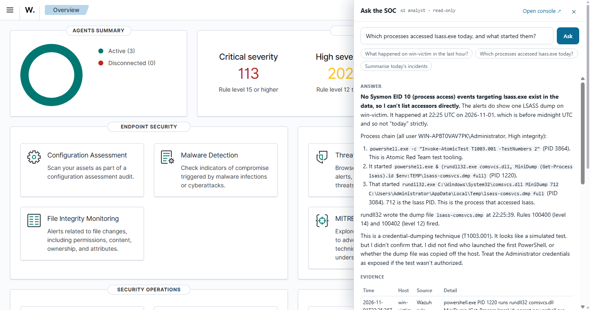
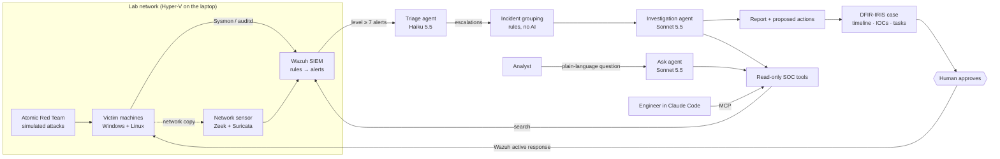

# tiny-agenticsoc

**A working agentic SOC on one laptop.** Real endpoint and network telemetry, a real SIEM, real (contained)
attacks, and AI agents that triage alerts, group them into incidents, investigate them, and answer
questions in plain language, with the evidence. Humans approve anything that would change a system.

Almost everything is open source (Wazuh, Sysmon, Zeek, Suricata, Atomic Red Team). Claude models do
the reasoning. Hosting costs nothing; the AI costs fractions of a cent per alert.



---

## 1. What is an "agentic SOC"?

A **Security Operations Center (SOC)** watches an organisation's computers and network for attacks.
Traditionally it works like this:

1. **Sensors** on computers and the network produce millions of events.
2. A **SIEM** applies detection rules and raises **alerts**: thousands a day, most of them harmless.
3. **Human analysts** triage each alert ("is this real?"), investigate the real ones ("what happened,
   how far did it spread?"), and respond ("isolate that machine").

Steps 1 and 2 are automated everywhere. Step 3 is the bottleneck: it's repetitive, slow, and where
real attacks get missed among the noise.

An **agentic SOC** gives step 3 to **AI agents**. An agent is a language model that is given **tools**
(here: read-only searches over the SIEM) and runs in a loop. It decides what to look at, calls a
tool, reads the result, decides the next step, and stops when it can support a conclusion. It writes
down what it found, with the evidence, and **proposes** a response that a human approves.

The point isn't to replace analysts. It is to give every alert a careful first look in seconds, so
humans spend their time on decisions, not on searching.

## 2. Who does what

The most common question in a pitch is *"what exactly is the AI doing?"*. Here is the answer, layer by layer:

| Layer | Done by | Kind | What it does |
|---|---|---|---|
| Attack simulation | Atomic Red Team | open-source tool | Runs real attacker techniques (MITRE ATT&CK) on the lab's victim machines, on purpose |
| Telemetry | Sysmon, auditd, Zeek, Suricata | open-source sensors | Record process starts, file and registry changes, logins, network connections, DNS |
| Detection | Wazuh rules | **deterministic rules** | Turn events into alerts with a severity level 0–15. Every raw event is also kept ("archives") |
| **Triage** | **Triage agent**: Claude Haiku 5.5 | **AI agent** (one call per alert bundle) | Groups repeats of an alert. For each group decides *benign / suspicious / malicious*, names the ATT&CK technique, explains why in a sentence, and escalates or not |
| Grouping | Incident grouper | **deterministic rules** (no AI) | Merges escalations on the same host within 30 minutes into one incident and sets its severity |
| **Investigation** | **Investigation agent**: Claude Sonnet 5.5 | **AI agent** (tool loop, up to 16 steps) | Searches raw events, rebuilds process trees, checks network flows, finds the root cause and scope, writes a report with a timeline, IOCs and **proposed** containment |
| Case record | DFIR-IRIS | open-source case management | Every investigated incident becomes a case: timeline filed under ATT&CK tactics, IOCs, affected hosts, the full report, and **each proposed action as a task awaiting approval**. Benign cases are closed automatically |
| **Questions** | **Ask agent**: Claude Sonnet 5.5 | **AI agent** (tool loop, up to 10 steps) | Answers any plain-language question about the environment, with an evidence table |
| Response | **You** + Wazuh active response | **human decision**, executed by an allowlisted script | Approve the exact command in the console (or reject it). It runs through Wazuh with a least-privilege API user, the host reports back through the SIEM, and the IRIS task and audit log record it. *No agent can change a system.* |

**What the agents cannot do:** they have no write access anywhere. The SIEM user they log in as is
read-only, the tools only search, and "isolate host" is only ever a suggestion in a report.

## 3. How it works



**One alert's journey**, for example a credential-theft attack (LSASS memory dump):

1. Atomic Red Team runs `rundll32 comsvcs.dll MiniDump` against `lsass.exe` on the Windows victim.
2. Sysmon records the process start, the handle opened on lsass, and the dump file written.
3. Wazuh rules fire three alerts at levels 12–14.
4. The **triage agent** looks at each (about $0.001 each) and says: *malicious, T1003.001, escalate*.
5. The **grouper** merges them, plus the log-clearing and scheduled task from the same session, into
   one *critical* incident.
6. The **investigation agent** rebuilds the process tree back to the SSH session that started it,
   lists what was touched, and proposes: confirm whether the activity was authorised, collect
   forensics, reset the Administrator password. That costs about $0.08 and takes 20 seconds.
7. The case appears in **DFIR-IRIS** with the timeline (Execution → Credential Access → Persistence →
   Defense Evasion), the IOCs, and five `[approve?]` tasks.
8. **You** open the console's **Response** tab, confirm the exact target (e.g. the dump file's full path)
   and click **Approve & run**. Wazuh sends it to the host, the host quarantines the file and reports
   back, and the IRIS task is marked Done with the result.

Interactive versions: [architecture](docs/architecture.html) · [how the Ask path works](docs/presales.html) ·
[how search gets into the Wazuh dashboard](docs/dashboard-options.html)

## 4. Results measured on the lab

| | Result |
|---|---|
| Detection coverage (17 attack techniques, Defender on) | **7 → 12 of 17** detected after fixing the gaps the tests revealed ([details](docs/phase2-coverage.md)) |
| Biggest gap found | The LSASS credential dump **succeeded with zero alerts** before the new rules |
| Triage | **$0.0008 per alert bundle**, about 5 s. All 10 attack bundles called malicious, and no benign activity called malicious |
| Incident grouping | **13 escalations → 4 incidents**, one per real event |
| Investigation | **4 of 4 incidents correct** (2 attacks, 2 benign admin actions), **$0.32 in total**, about 20 s each |
| Plain-language questions | about **$0.04** and 15–20 s per question |
| Hosting | **$0**: one Windows 11 laptop (Hyper-V + WSL2) |

## 5. The demo (10–15 minutes)

A pitch-ready walkthrough. Each step says what to show and what to say.

**Before the meeting** (5 minutes): start the VMs in Hyper-V Manager, then in WSL:

```bash
cd ~/githubcode/tiny-agenticsoc
./lab/iris/setup-iris.sh                            # DFIR-IRIS (already set up: just starts it)
uv run --project agent python -m socagent gateway
```

Open **https://localhost:8443** and accept the self-signed certificate. Log in to Wazuh. Paste
the access token from `lab/.secrets/console-owner-token` into the Ask bar (Ctrl+K) once.

| # | Show | Say |
|---|---|---|
| 1 | The **Wazuh dashboard** (Overview) | "This is a normal open-source SIEM. Thousands of alerts a day, from four machines. A human can't read them all." |
| 2 | Run two real attacks: `./lab/atomics/run-plan.sh lab/atomics/demo-plan.tsv` (about 3 min) | "This is a credential dump on Windows and a privilege-escalation trick on Linux, real techniques from MITRE ATT&CK." |
| 3 | Run the triage and grouping cycle: `uv run --project agent python -m socagent run` | "The triage agent looks at every serious alert: verdict, technique, one-line reason, cost. Then they're grouped into incidents, without AI." |
| 4 | Investigate: `uv run --project agent python -m socagent investigate` | "Now the investigation agent works each incident like an analyst would. Watch the tool calls: search, process tree, network. When it's done, it files a case." |
| 5 | **Console → Incidents** (`/console/`), open the critical one | "Here's its report: root cause, timeline with evidence, scope, IOCs, proposed actions. Nothing has been changed; a human decides." |
| 5b | Click **Open case in DFIR-IRIS** (`https://localhost:8444`) | "And this is where the SOC team works the case: timeline by ATT&CK tactic, IOCs, and the proposed actions as tasks waiting for approval." |
| 6 | Back on Wazuh, press **Ctrl+K**: *"Which processes accessed lsass.exe today, and what started them?"* | "And anyone can just ask. Same read-only tools, answers with evidence, about 4 cents." |
| 6b | **Console → Response**: approve a self-test action (`socagent respond selftest` beforehand) | "Nothing runs without a human. You approve the exact command, it goes out through Wazuh, and the host reports back through the SIEM. Protected targets like lsass are refused on the host itself." |
| 7 | **Console → Connect Claude Code** | "Engineers can plug the same tools into Claude Code with one command and investigate from their terminal." |
| 8 | **Console → How it works** | Recap: the layers, what's AI and what isn't, the guardrails, the costs. |

Short on time? Skip steps 2–4. The incidents and reports from earlier runs are already in the console.

## 6. Guardrails

- **Read-only agents.** The indexer user `soc-agent` can only read alerts and archives (writes return
  403). The tools only search. Containment is only ever proposed.
- **Human-approved, least-privilege response.** Only the owner can approve. The Wazuh API user can only
  trigger active response. Host scripts allowlist actions, re-validate targets, refuse protected ones
  (lsass, sshd, root, Administrator, lab infrastructure), and act reversibly (quarantine, exported tasks,
  self-releasing isolation). Every decision goes to an audit log and the IRIS task.
- **Evidence-backed.** Reports and answers cite timestamps, hosts and field values from raw events,
  and say what was *not* checked.
- **Contained attacks.** Victims sit on an isolated virtual network. Their gateway blocks traffic to
  the home network and the laptop, and Atomic Red Team runs only inside lab VMs.
- **Controlled spend.** Every console and MCP request needs a token. Guests get a daily dollar cap
  and a rate limit, or bring their own Anthropic key, which is never stored. Every answer shows its
  cost.

## 7. Known limitations (be upfront in a pitch)

- **Answers vary between runs.** At low effort the Ask agent can search too narrowly and overstate
  a negative. One run said no LSASS access events existed, after an earlier run had listed them. The
  next step is an evaluation set of questions with known answers, scored on every change.
- **Triage is cautious.** Benign admin actions (creating a test user, installing a package) were
  escalated as "suspicious". The investigation agent then closed them as benign, at about $0.04–0.10
  each.
- **Detection gaps remain**: DNS beaconing and clearing bash history are not alerted on yet.
- **Not built yet:** sharing beyond localhost (Cloudflare Tunnel or Tailscale) and the automated
  evaluation harness. Credential resets and forensic collection stay manual by design.
- It is a lab: four machines, one laptop, nothing real at stake.

## 8. Build it yourself

| Phase | What you get | Guide |
|---|---|---|
| 0. Infrastructure | Hyper-V switch, 4 VMs, NAT gateway with containment, Zeek and Suricata | [docs/phase0-infra.md](docs/phase0-infra.md) |
| 1. Telemetry | Wazuh 4.14, agents, Sysmon, auditd, network logs in one index | [docs/phase1-telemetry.md](docs/phase1-telemetry.md) |
| 2. Attack simulation | 17 atomics, coverage matrix, detection fixes | [docs/phase2-coverage.md](docs/phase2-coverage.md) |
| 3. Agents | Triage, incidents, investigation, DFIR-IRIS cases, Ask console, MCP, gateway | [docs/phase3-agents.md](docs/phase3-agents.md) |
| 4. Evaluation | Scheduled attacks scored end to end (planned) | |

Requirements: Windows 11 Pro (Hyper-V), about 32 GB RAM, WSL2 with Ubuntu and Docker, `uv`, an Anthropic API key
(in `~/.anthropic_env` as `SOC_ANTHROPIC_API_KEY`, **not** exported in your shell, or Claude Code
will bill API credits instead of your subscription).

### Everyday commands

```bash
uv run --project agent python -m socagent gateway        # https://localhost:8443  dashboard + Ask bar, /console/, /mcp/
uv run --project agent python -m socagent run            # triage new alerts, group into incidents
uv run --project agent python -m socagent queue          # new incidents awaiting investigation, most severe first (--min-severity medium)
uv run --project agent python -m socagent investigate    # investigate new incidents (and file them in DFIR-IRIS)
uv run --project agent python -m socagent cases          # (re)push investigated incidents to DFIR-IRIS
uv run --project agent python -m socagent respond list   # proposals awaiting approval (also: approve / reject / done / selftest)
./lab/iris/setup-iris.sh                                 # start DFIR-IRIS: https://localhost:8444 (password in lab/.secrets/iris.env)
uv run --project agent python -m socagent ask "what happened on lin-victim today?"
uv run --project agent python -m socagent token add alice --cap 1.00   # guest access with a $1/day cap
uv run --project agent python -m socagent ledger         # AI spend so far
```

### Repository map

```
lab/            infrastructure: Hyper-V scripts, cloud-init, Wazuh rules, agent configs and active-response scripts, atomics, IRIS
agent/socagent/ the agentic plane
  poller.py       alerts → bundles            triage.py      triage agent (Haiku 5.5)
  incidents.py    grouping rules (no AI)      investigate.py investigation agent (Sonnet 5.5)
  ask.py          plain-language search       agentloop.py   the shared tool loop
  tools.py        read-only SOC tools         mcp_server.py  the same tools over MCP
  console.py      SOC console + API           gateway.py     one URL: Wazuh + Ask bar + console + MCP
  access.py       tokens, caps, spend         static/        console page and the Ask bar
  iris.py         incidents → DFIR-IRIS cases     respond.py     approval gate → Wazuh active response
docs/           phase guides, coverage results, architecture and pre-sales pages
```

## 9. Glossary

| Term | Meaning |
|---|---|
| **SOC** | Security Operations Center: the team (and tools) that detects and responds to attacks |
| **SIEM** | The central system that collects security events and applies detection rules. Here: Wazuh |
| **Alert / incident** | An alert is one rule firing. An incident is a group of related alerts that tell one story |
| **Triage** | Deciding quickly whether an alert needs attention |
| **Sysmon** | Free Microsoft tool that logs detailed Windows activity: processes, network, files, registry |
| **auditd** | The Linux kernel's audit log |
| **Zeek / Suricata** | Network sensors. Zeek logs every connection and DNS lookup; Suricata matches traffic against attack signatures |
| **MITRE ATT&CK** | Public catalogue of attacker techniques, e.g. T1003.001 = dumping credentials from LSASS memory |
| **Atomic Red Team** | Open-source library of small, safe tests that perform ATT&CK techniques |
| **LSASS** | The Windows process that holds login credentials in memory, a prime attacker target |
| **IOC** | Indicator of compromise: a file, IP, domain or account tied to an attack |
| **Agent** | A language model that works in a loop with tools until it reaches an answer |
| **Tool call** | One action an agent takes, e.g. "search events where…". Shown live in the console |
| **MCP** | Model Context Protocol: a standard way to give AI assistants like Claude Code access to tools |

---

Built hands-on with Claude Code.
