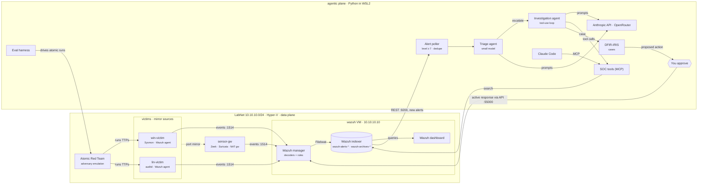

# An agentic SOC on one laptop

*tiny-agenticsoc · architecture · status as of 1 Nov 2026*

A small but realistic security operations center: real endpoint and network telemetry, a real
SIEM, real (contained) attacks, and LLM agents that triage and investigate the alerts, with a
human approving every response.

Almost everything is open source. The lab runs on a single Windows 11 laptop under Hyper-V, so
hosting costs nothing. The only spend is LLM tokens: about $0.0008 to triage an alert bundle and $0.04 to $0.10 to
investigate an incident.

> An interactive version of this page, with a clickable diagram and path tracing, is in
> [`architecture.html`](architecture.html).

## The big picture

The top band is the **data plane**: attacks run on the victims, host and network sensors record
them, and Wazuh decodes, detects and stores everything. The bottom band is the **agentic
plane**: it reads alerts out of storage, reasons over them with tools and LLMs, writes a case,
and can only act on the lab after a human approves.

## The jobs, and who does each one

| Job | What happens | Component | License | Runs on | Status |
|---|---|---|---|---|---|
| Simulate | Run real ATT&CK techniques on purpose | Atomic Red Team + Invoke-AtomicRedTeam | MIT | inside victims | ✅ live |
| Generate | Process, registry, network, PowerShell events on Windows | Sysmon (sysmon-modular config) | free, closed source | win-victim | ✅ live |
| Generate | Syscalls, execs, file and user changes on Linux | auditd (Neo23x0 ruleset) | GPL-2.0 | lin-victim | ✅ live |
| Generate | Connection logs, protocol metadata, signature alerts | Zeek, Suricata (ET Open) | BSD-3 / GPL-2.0 | sensor-gw | ✅ live |
| Ingest | Collect, ship, decode, apply detection rules | Wazuh agent → Wazuh manager | GPL-2.0 | every host → wazuh VM | ✅ live |
| Store | Index alerts and every raw event, searchable | Filebeat → Wazuh indexer (OpenSearch) | Apache-2.0 | wazuh VM | ✅ live |
| Look | Dashboards and search for humans | Wazuh dashboard | Apache-2.0 / GPL-2.0 | wazuh VM | ✅ live |
| Reason | Decide what matters, investigate, explain | Triage + investigation agents (Python) | this repo | WSL2 | ✅ live |
| Reason | Give agents and Claude Code the same SOC tools | MCP server | this repo | WSL2 | Phase 3 |
| Reason | Route each task to a suitable model | Anthropic API (OpenRouter optional, triage only) | paid API | cloud | ✅ live |
| Record | Cases, timelines, IOCs, analyst notes | DFIR-IRIS | LGPL-3.0 | WSL2 (Docker) | ✅ live |
| Act | Isolate host, kill process, block IP, after approval | Wazuh active response | GPL-2.0 | manager → agents | Phase 3 |
| Measure | Did we detect it, judge it right, and at what cost? | Eval harness | this repo | WSL2 | Phase 4 |

## Follow one attack through the system

Take a single technique, `T1059.001` (malicious PowerShell), from the moment it runs to the
moment the case closes.

1. **Simulate.** The eval harness asks Invoke-AtomicRedTeam on `win-victim` to run T1059.001 and
   records what it expects to be detected.
2. **Generate.** Sysmon logs a process-create event (ID 1) with the full command line and parent
   process, and Windows logs PowerShell script block event 4104. If the script calls out to the
   internet, Zeek logs the connection and DNS query, and Suricata may fire a signature. Both
   stamp the same `community_id` on the flow.
3. **Ingest.** The Wazuh agent forwards the events over port 1514. On the manager, decoders turn
   them into fields and rules give them a level. A suspicious PowerShell rule might reach level
   10 or higher.
4. **Store.** Filebeat writes the alert to `wazuh-alerts-*`, and every raw event, alerting or not,
   to `wazuh-archives-*`.
5. **Triage.** The poller picks up the new alert (level 7 or above) and groups it with related
   alerts from the same host and time window. A small, cheap model maps it to ATT&CK and gives a
   verdict: benign, suspicious or escalate.
6. **Investigate.** On escalation, a stronger model runs a tool-use loop. It rebuilds the process
   tree from Sysmon, pivots on the `community_id` into Zeek and Suricata, checks IPs and hashes
   against threat intel, and writes up what happened.
7. **Record.** The agent opens a DFIR-IRIS case with the timeline, evidence, IOCs and a proposed
   response.
8. **Act.** You approve or reject. On approval, the agent calls the Wazuh API and the manager
   pushes the active response, for example killing the process or isolating the host.
9. **Measure.** The harness checks the result: was it detected, was the verdict right, how long
   did it take, and how many tokens and dollars did it cost.

## The lab underneath

Four Hyper-V VMs on an internal switch. Ubuntu VMs are built from the official cloud image and
configured by cloud-init, so the whole lab can be rebuilt from the repo.

| VM | Address | RAM | Role |
|---|---|---|---|
| `sensor-gw` | 10.10.10.1 | 2 GB | NAT gateway, DNS/DHCP, Zeek, Suricata |
| `wazuh` | 10.10.10.10 | 6 GB | manager, indexer, dashboard |
| `win-victim` | 10.10.10.20 | 2–4 GB | Windows Server 2022 eval |
| `lin-victim` | 10.10.10.21 | 1–1.5 GB | Ubuntu 24.04 |

## Guardrails

- **Containment.** All victim traffic leaves through `sensor-gw`, which drops anything bound for
  private, CGNAT or link-local ranges. Attacks can reach the internet but not the home network or
  the laptop. The host also blocks unsolicited inbound traffic from the lab.
- **Visibility.** Victim NICs are Hyper-V port-mirror sources, so the sensor also sees lateral,
  victim-to-victim traffic that never touches the gateway.
- **Cost.** Hosting is free. LLM calls only go out for alerts at level 7 or above, cheap models
  handle triage, and the OpenRouter account has a hard credit cap. Each case records its own
  token cost.
- **Authority.** Agents read freely, but every action on the lab needs a human click.

## Roadmap

| Phase | Status | Scope |
|---|---|---|
| 0 | ✅ done | Hyper-V switch and VMs, NAT and containment, Zeek and Suricata with community-id, verified with a test alert |
| 1 | ✅ done | Wazuh all-in-one with archives on, agents grouped as sensor, linux and windows, Sysmon, auditd, local Zeek rules |
| 2 | ✅ done | 17 atomics with Defender on, coverage matrix with harness-noise subtraction, new rules for LSASS dumping, cron, setuid, schtasks and log clearing: 7 → 12 of 17 detected |
| 3 | 🔨 in progress | Poller, triage and investigation agents, MCP tool server, DFIR-IRIS cases, approval-gated active response |
| 4 | planned | Eval harness: scheduled atomics produce a scorecard of detection, verdict accuracy, latency and cost per alert |

---

*Built hands-on with Claude Code.*
